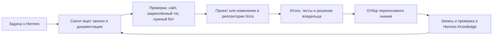

# Hermes Agent Architect как развивающийся скилл

**Статус:** исторический проект решения от 15 октября 2026 года. Итоговая
структура после решения владельца находится в
`alex_claude_marketplace/plugins/hermes-agent-architect/skills/hermes-agent-architect`.
Ниже сохранён ход проектирования, включая старые пути и отвергнутый вариант
отдельного репозитория. Действующие инструкции — в соседних `SKILL.md`,
`README.md` и `references/knowledge-policy.md`. Перенос не выпускает ботов.

## Цель

Codex должен применять накопленный опыт работы с Hermes при проектировании
следующего бота: находить подходящий штатный механизм, объяснять выбор,
показывать применимость к версии и конкретному сервису, а после работы
сохранять новые проверенные знания и принятые владельцем решения. Владелец
должен иметь возможность читать и исправлять эту историю как обычные файлы Git.

Успех виден в двух сценариях:

1. На запрос «создай Hermes-бота с памятью и расписанием» скилл находит
   релевантные возможности, прежние решения и шаблоны; явно проверяет
   закреплённый образ и состояние целевого сервиса; выдаёт проект с источниками,
   тестами и откатом.
2. После новой работы с Hermes подтверждённое наблюдение или архитектурное
   решение попадает в подходящую запись, становится находимым в следующей
   задаче и не превращает непроверенную гипотезу в «факт платформы».

## Что уже есть и чего не хватает

Установленный скилл
`/home/ubuntu/.codex/skills/hermes-agent-architect` сейчас является ссылкой
на `/srv/repos/hermes-knowledge/skills/hermes-agent-architect`. Поэтому
`SKILL.md` уже доступен Codex, и правки внутри этой вложенной папки видны
при следующем чтении скилла без копирования. Но проект как целое расположен
**на два уровня выше установленного скилла**: каталог, скрипты, исследования
и upstream находятся вне папки, которую пользователь открывает как скилл.
Они тоже доступны по путям, указанным в `SKILL.md`; перенос нужен для одного
канонического корня и удобной работы, а не для устранения задержки синхронизации.
Сейчас `SKILL.md` и `decision-guide.md` помогают выбрать механизм, закреплённый
upstream submodule и `docs-catalog.json` помогают проверить версию, а два
документа о памяти дают глубокий пример исследования.

Механизм обновления уже сейчас выглядит так:

```text
Codex: ~/.codex/skills/hermes-agent-architect
                    │ символическая ссылка
                    ▼
Git: /srv/repos/hermes-knowledge/skills/hermes-agent-architect
```

На этом VPS правка файлов в целевой папке сразу меняет файлы установленного
скилла; при следующем чтении Codex получает новую версию. `git pull` нужен
только для получения чужих коммитов из remote. Сам `git pull` не требуется
после локальной правки и не вызывается скиллом автоматически. Если решение
осталось в `docs/` за пределами целевой папки, скилл найдёт его только через
ссылку или инструкцию в `SKILL.md`; для этого и предлагается единый корень.

Целевой вариант — **один канонический корень**, который одновременно является
Git-репозиторием, папкой скилла и основной папкой проекта Codex. Также не хватает формата для
новых решений, порядка перевода наблюдений в повторно используемое знание,
поиска по этим записям и проверки их актуальности.
Репозиторий пока не имеет первого коммита и remote, поэтому история обучения
скилла ещё не защищена Git-историей или синхронизацией.

## Варианты

| Подход | Плюсы | Ограничение |
| --- | --- | --- |
| Дописывать каждое открытие в `SKILL.md` | Самый быстрый старт | Большие инструкции загружаются при каждом вызове; факты, решения и частные случаи смешиваются. |
| **Короткий скилл + записи с доказательствами в Git** | Находится по теме, сохраняет историю и границы версий; не требует новой службы | Нужны простые правила записи и проверки. |
| Внешняя семантическая память | Удобна при очень большом корпусе | Дополнительные сервис, права и синхронизация; ответы сложнее привязать к версии и первичному источнику. |

Выбор для первого этапа — второй подход. Поиск по имени, тегам и тексту
достаточен для корпуса такого размера. Семантический индекс стоит добавлять
только после измеренного провала обычного поиска; он будет производным индексом,
а не источником истины.

## Канонический репозиторий и структура знаний

```text
/srv/repos/hermes-agent-architect/  # корень Git и скилла
  SKILL.md                          # короткий маршрут работы
  references/
    decision-guide.md               # существующая карта механизмов
    knowledge-policy.md             # как проверять и пополнять знания
    capabilities/                   # возможности и границы версий
    decisions/                      # принятые архитектурные решения
    patterns/                       # переносимые рецепты проектирования
  docs/
    hermes-platform-overview.md     # единый глубокий обзор для человека
    hermes-memory-architecture.md   # существующее исследование
    ...
  data/docs-catalog.json            # указатель на официальную документацию
  upstream/hermes-agent/            # неизменённый закреплённый submodule
  scripts/find_docs.py              # существующий поиск документации
  scripts/find_knowledge.py         # поиск записей скилла
  scripts/validate_knowledge.py     # структура, ссылки, версии и статусы
```

`/home/ubuntu/.codex/skills/hermes-agent-architect` указывает прямо на
корень этого репозитория. Открывая проект Codex по
`/srv/repos/hermes-agent-architect`, владелец исследует платформу и правит
тот же набор файлов, который читает установленный скилл. Отдельной операции
«скопировать обновления в скилл» нет. При новом чтении скилл видит текущие
файлы; уже загруженный контекст активного хода может потребовать перечитать
изменённую запись.

`SKILL.md` не хранит длинный пересказ платформы. Он описывает, когда читать
обзор, руководство выбора, запись решения или рецепт, и задаёт порядок
проверки. Переиспользуемые знания живут в `references/`; полный обзор
остаётся одним читаемым человеком документом в `docs/` и связан со скиллом.
Одна мысль имеет одно основное место хранения, чтобы файлы не расходились.

### Типы записей

- **Capability:** что делает Hermes, при каких параметрах, с какого
  подтверждённого тега и по каким исходникам. Отдельно указано, что описано на
  текущем сайте, что есть в `v2026.9.14`, а что наблюдалось на VPS.
- **Decision (ADR):** задача, выбранный механизм, рассмотренные альтернативы,
  причина, владелец решения, область применения, последствия и условие
  пересмотра. Статус: `proposed`, `accepted` или `superseded`. Решение
  получает `accepted` только если владелец действительно выбрал его.
- **Pattern:** повторяемая схема для нового бота: входные условия, компоненты,
  границы данных и прав, настройки без секретов, проверка и откат. Ссылается на
  capability и ADR, а не переписывает их.
- **Observation:** краткая проверка или сбой с датой, образом/версией и методом
  воспроизведения. Временное наблюдение не объявляется универсальным свойством
  Hermes. Его можно позднее превратить в capability или pattern.

Каждая запись имеет стабильный ID, тему, статус, область применения, дату
проверки, версию, ссылки на доказательства и, если нужно, ссылку
`supersedes`. Тело — обычный Markdown. Валидатор проверяет структуру и
существование локальных ссылок, но не подменяет проверку фактов человеком.
Секреты, реальные профили, личная память, сессии и ответы API с учётными
данными сюда не попадают.

## Цикл применения и обновления



**Перед проектированием.** Скилл ищет локальные capability, ADR и pattern,
затем точный файл из `docs-catalog.json` в закреплённом submodule. Для
изменчивых функций сверяет текущий официальный источник. Если речь о
работающем боте, отдельно читает реестр сервисов, его исходный репозиторий,
Compose, образ и профиль. Запись «есть в документации» не означает «включено
в этом контейнере».

**После задачи.** Codex делает короткий отбор: появилась ли проверенная
особенность платформы, переносимое решение, новый рабочий шаблон или только
частный результат этого сервиса. Проверенные переносимые выводы добавляются
в скилл по ходу работы. Архитектурное решение записывается как принятое лишь
после выбора владельца; до этого оно остаётся предложением. Частные
операционные состояния обновляются в реестре ботов, а не копируются в этот
справочник. Если доказательств недостаточно, фиксируется вопрос на проверку,
без рекомендации использовать функцию в production.

**Проверка записи.** Перед сохранением: источник и версия указаны, вывод
соответствует источнику, граница применимости понятна, нет секретов и личных
данных, ссылки работают, существующие решения не дублируются. После этого
запись попадает в Git-коммит с понятной темой. Изменение knowledge-репозитория
не меняет контейнеры.

## Отношение к памяти Hermes

Знания архитектора — **память процесса разработки Codex**, версиями которой
управляет Git. Она не является `MEMORY.md`, `USER.md`, `state.db` или
`MemoryProvider` работающего Hermes-бота. В справочник можно внести
переносимое правило выбора провайдера памяти, но нельзя копировать память
пользователя или общий writable-профиль нескольких ботов.

## Внедрение

1. Сохранить текущий исходный набор как базовую Git-ревизию, исключив
   `mitm_mcp_traffic.db` и другие runtime/секретные файлы. Проверить, что
   submodule чистый и закреплён на `v2026.9.14`.
2. Перенести `SKILL.md` и `references/` в корень репозитория, затем
   переименовать checkout в `/srv/repos/hermes-agent-architect`.
   Сохранить `/srv/repos/hermes-knowledge` как ссылку совместимости,
   обновить внутренние абсолютные/относительные ссылки, реестр проектов и
   карту сервисов. Атомарно переключить установленную ссылку Codex на новый
   корень. После этого проверить загрузку скилла, поиск документации,
   доступность submodule, Git-статус и старые ссылки. Никакие контейнеры
   при этом не перезапускаются.
3. Добавить `knowledge-policy.md`, минимальные шаблоны записей и проверку.
   Перенести в первые записи только уже подтверждённые решения из текущего
   `decision-guide.md` и исследований, не переписывая upstream.
4. Добавить поиск по записям и маршрутизацию в короткий `SKILL.md`. Проверить
   на трёх запросах: новый бот, выбор памяти, изменение существующего gateway.
   Ответ должен ссылаться на нужные записи и явно отличать версию от runtime.
5. Составить `hermes-platform-overview.md` как единый обзор функций,
   документации, памяти и расширений. Он использует каталог и записи скилла,
   а не создаёт вторую независимую базу фактов.
6. Вести пополнение после последующих задач. Когда официальный индекс
   меняется, обновлять его отдельным diff; менять закреплённый submodule и
   версию бота только отдельными решениями и проверками совместимости.

Для большинства сессий на этом VPS приватный Git remote не требуется для
немедленного применения обновлений: установленная ссылка читает локальный
checkout. Remote полезен как резервная копия и для других машин, но не должен
становиться вторым рабочим источником знаний.

## Критерии приёмки

- Скилл вызывается для задач проектирования Hermes и находит нужную запись
  без чтения всего корпуса.
- Каждая рекомендация различает текущую документацию, закреплённую версию и
  подтверждённое состояние конкретного бота.
- Новое решение после задачи можно найти по теме и понять по его источникам,
  почему оно было принято и когда его пересмотреть.
- Изменения знания проверяются и видны в Git; установленный скилл и проект
  Codex указывают на один корень, без ручного копирования.
- В репозитории нет профилей, токенов, сессий, личной памяти и производных
  файлов сетевых инструментов.

Режим пополнения по умолчанию в этом проекте: автоматически сохранять
проверенные переносимые выводы после работы с Hermes; решения владельца
помечать как принятые только при его явном выборе. Это правило можно сменить
на согласование каждой записи без изменения структуры хранилища.
