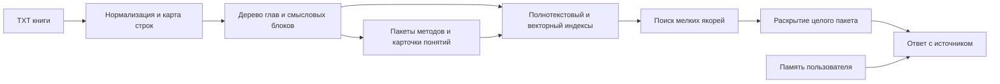
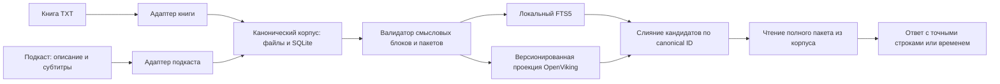

# Архитектура памяти книг и подкастов для узких Hermes-ботов

Для нескольких узких Hermes-ботов с **3–5 книгами на бота**, структурированными TXT, подкастами и одним пользователем выбираю гибрид **A + C**. Локальный версионируемый корпус A хранит исходники, смысловые границы, связанные части упражнений и точные ссылки. OpenViking C даёт дополнительную иерархическую навигацию и семантический поиск по производной проекции этого корпуса. Маленький поисковый якорь приводит бота к **целостному пакету** из книги или выпуска; ответ строится после чтения всего обязательного контекста. Варианты A, B, C и D ниже сохранены для сравнения, а устройство выбранного гибрида описано в разделе 9.

## 1. Что именно строим

«Натренировать по книгам» здесь означает подготовить внешний корпус и заставить бота обращаться к нему во время ответа. Дообучение весов модели не даёт надёжной ссылки на конкретное место книги и усложняет исправление ошибочной интерпретации. Исходная идея RAG состоит в соединении генеративной модели с доступной при запросе внешней памятью; сохранение происхождения ответа — одна из причин держать знания вне весов модели. [Lewis et al., NeurIPS 2020](https://proceedings.neurips.cc/paper/2020/file/6b493230205f780e1bc26945df7481e5-Paper.pdf).

Разделите три типа данных:

1. **Книжная библиотека** — авторские утверждения, практики и точные фрагменты. Она версионируется и остаётся неизменяемым источником при каждом запросе.
2. **Память человека** — предпочтения, цели, история беседы и согласованный прогресс. Она приватна для пользователя и не превращается в текст книги.
3. **Правила бота** — его роль, доменная область, способ работы с источниками и ограничения применения. Они живут в конфигурации и инструкциях, а не возникают из автоматического извлечения случайного абзаца.

В закреплённом Hermes `v2026.9.14` один внешний `MemoryProvider` на профиль даёт `prefetch`, инструменты и хуки сессии; встроенная память работает параллельно. `prefetch` имеет тайм-аут 8 секунд и обычно должен возвращать небольшой контекст. Для изучения книги перед ответом лучше отдельные `book_search`/`book_read` инструменты через обычный Hermes plugin или локальный MCP-сервис. Так книжный корпус не занимает единственный слот провайдера личной памяти и бот может выполнить многошаговое чтение. [Контракт провайдера](https://github.com/NousResearch/hermes-agent/blob/v2026.9.14/website/docs/developer-guide/memory-provider-plugin.md), [обычные плагины Hermes](https://github.com/NousResearch/hermes-agent/blob/v2026.9.14/website/docs/developer-guide/plugins/index.md).



## 2. Что дают исследования и где их границы

**Искать мелкое, читать крупное.** `AutoMergingRetriever` в [LlamaIndex](https://developers.llamaindex.ai/python/framework/integrations/retrievers/auto_merging_retriever/) и [Haystack](https://docs.haystack.deepset.ai/docs/automergingretriever) находит дочерние фрагменты и поднимает их до родителя, когда совпало достаточно детей. Это решает проблему разорванного контекста при ответе. Однако готовые `HierarchicalNodeParser`/`HierarchicalDocumentSplitter` по умолчанию строят уровни по *размеру* фрагмента, а не по настоящему аргументу автора. Для ваших книг границы родителя придётся определять самим.

**Поисковому якорю нужен заголовок.** В [Contextual Retrieval](https://www.anthropic.com/engineering/contextual-retrieval) короткий контекст документа добавляется к фрагменту перед embedding и BM25. Для книги это значит индексировать «Книга → глава → тема → этот абзац», чтобы текст вроде «выполните это вечером» не терял название упражнения. Контекст служит для *поиска*; в цитате и проверке ответа остаётся исходный абзац. У Anthropic есть результаты на собственном наборе, но их проценты нельзя переносить на русскоязычные книги без теста.

**Иерархические summary помогают широким вопросам.** [RAPTOR](https://arxiv.org/abs/2401.18059) строит дерево кластеров фрагментов и рекурсивных аннотаций, чтобы отвечать на вопрос обо всей книге. Это полезно для «какова позиция автора», но кластеризация по сходству может объединить удалённые по тексту эпизоды, а summary может опустить оговорку. Поэтому RAPTOR-подобные аннотации здесь — навигация, не доказательство и не замена исходного метода.

**Контекстные embeddings можно улучшить без переписывания текста.** [Late Chunking](https://arxiv.org/abs/2409.04701) сначала кодирует длинный фрагмент, затем усредняет токены внутри коротких чанков. Это сохраняет окружение в векторе, но не устраняет необходимость задавать границы смысловых блоков. На небольшом CPU VPS это опциональный эксперимент после базовой оценки, а не обязательный этап.

**Граф нужен для особого класса вопросов.** [GraphRAG](https://arxiv.org/abs/2404.16130) даёт выигрыш на глобальных вопросах по большому корпусу за счёт извлечения сущностей и аннотаций сообществ. Для 3–5 книг на бота это слишком дорогая первая ступень. Связи «понятие → упражнение → обоснование → ограничение» можно хранить обычными таблицами; графовый backend добавлять, когда реальные вопросы требуют длинных переходов между книгами.

## 3. Конвейер обработки книги

**Приём и сохранение.** При загрузке сохраняйте исходные байты вне Git, SHA-256, издание, автора, язык и разрешённую область бота. Определите кодировку, приведите рабочую копию к UTF-8, уберите артефакты переноса строк и повторяющиеся колонтитулы. Сохраните отображение `нормализованный символ/строка → исходная строка/позиция`; иначе после чистки нельзя честно показать место в книге. Если в TXT нет номеров страниц, ссылка должна указывать главу, раздел и строки, а не выдуманную страницу.

**Синтаксическое дерево.** Поскольку ваши TXT обычно сохраняют структуру, первым проходом детерминированно находите оглавление, главы, подглавы, списки, упражнения, примечания и абзацы. Сверяйте найденные заголовки с оглавлением. Модель может предложить только спорные границы; низкая уверенность идёт на ручную проверку. Проверка покрытия должна подтвердить, что каждый содержательный абзац принадлежит одному исходному узлу, порядок сохранён и нет пропавшего текста. Структура: `книга → глава → раздел → смысловой блок → абзац/поисковый якорь`.

**Смысловые границы.** Раздел можно разделить на два блока, если автор явно меняет тезис, задачу, метод или контекст применения. Нельзя разрывать введение к упражнению и его шаги, перечисление и пояснение к нему, рекомендацию и оговорку. Если один абзац огромен, допускается искать по предложениям, но он остаётся частью единого родителя. Размер в токенах — ограничитель чтения, а не главный критерий сегментации.

**Пакет метода.** Для практики создавайте `method_bundle` со связанными ролями: `purpose`, `rationale`, `explanation`, `steps`, `example`, `limits`, `author_recommendation`, `follow_up`. Роли существуют лишь там, где автор действительно дал соответствующий материал; пустое поле не означает, что метод безопасен или ограничений нет. Состав пакета может пересекать несколько соседних подразделов или, если автор вернулся к методу позже, несколько точных диапазонов книги. Отмечайте обязательные части: ответ с упражнением запрещён, пока они не прочитаны полностью.

Например, вопрос «Как научиться говорить нет?» может совпасть с одним абзацем о границах. Поиск использует этот абзац как якорь, но выдача для ответа поднимается к пакету, где автор объяснил цель, привёл четыре шага, пример и оговорку о применимости. Бот видит весь пакет в порядке книги и ссылку на каждый диапазон. Четыре шага без обоснования и оговорки не становятся самостоятельной «рекомендацией автора».

**Карточки понятий.** Дополнительно извлекайте короткие карточки: название метода, синонимы, вопрос читателя, тезис автора, связь с пакетом, глава и исходные диапазоны. Они улучшают поиск по разговорным запросам; карточка никогда не служит единственным доказательством. Для важных упражнений и неоднозначных мест человек утверждает карточку и границы. Отдельно помечайте: «утверждение автора», «подтверждено другим источником», «оценка доказательности не проводилась». Книга может описывать психологический механизм уверенно, но сама по себе не доказывает его клиническую эффективность.

**Индексация и публикация.** Создавайте полнотекстовый индекс по заголовкам, синонимам и поисковым якорям; локальные embeddings по якорям и карточкам — второй канал поиска. Аннотации главы и раздела индексируйте отдельно для широких вопросов. Индекс собирается во временную версию, проходит проверки и только затем атомарно становится активным. Асинхронное «задание принято» не означает, что книга уже полностью доступна. При новой редакции перестраивайте индекс и сохраняйте старую версию для отката.

## 4. Хранение и инвариант полноты

Минимальная реляционная модель:

```text
books(id, edition, sha256, title, author, language, bot_scope, status)
nodes(id, book_id, parent_id, kind, ordinal, start_line, end_line,
      start_char, end_char, heading_path, text_sha256, abstract)
bundles(id, book_id, kind, title, completeness_rule)
bundle_members(bundle_id, node_id, role, required, ordinal)
concepts(id, canonical_name, aliases, status)
concept_sources(concept_id, node_id, relation, review_state)
search_fts(node_id, heading_path, contextual_label, text)
search_vectors(node_id, embedding_model_version, vector)
```

Сами тексты и индексы могут лежать в SQLite; для embeddings допустим отдельный локальный LanceDB. [SQLite FTS5](https://sqlite.org/fts5.html) поддерживает полнотекстовый поиск и BM25, а [LanceDB](https://docs.lancedb.com/search/hybrid-search) — локальные векторы и hybrid search. Если FTS5 использует external-content таблицу, синхронность индекса и исходных строк надо проверять при каждой пересборке. Идентификатор версии книги и хеш исходника входят в каждый ответ инструмента: смешать разные редакции нельзя.

**Главный инвариант:** поисковый фрагмент не равен доказательству. Инструмент `book_read_bundle` возвращает `complete=true` только когда все обязательные части метода загружены и целостность диапазонов проверена. Если весь обязательный пакет не помещается в доступный контекст модели, `complete=false` и бот не выдаёт инструкцию. Последовательная выдача страниц не решает проблему: ранние части могут выпасть из контекста до ответа. При импорте чрезвычайно длинный метод нужно переразметить на законченные подметоды с общими обязательными пояснениями и отдельно проверить каждый такой пакет; произвольная обрезка недопустима.

## 5. Извлечение при запросе и форма ответа

1. **Маршрутизация.** Определить `bot_scope`, допустимые книги и тип запроса: точный факт, объяснение, упражнение, сравнение методов или широкий синтез. Scope применяется до поиска, а не только при формировании ответа.
2. **Поиск кандидатов.** Искать параллельно по FTS5/BM25, embeddings коротких якорей и карточкам понятий. Контекстуализированный текст для индекса содержит путь заголовков; исходный текст не переписывается. Объединять ранги, а не складывать несопоставимые сырые score; векторные совпадения не должны вытеснять точный термин автора.
3. **Перечитать источник.** Для топ-кандидатов подняться к родителю и `method_bundle`. Обычный ответ получает целостный раздел, если он помещается в контекст. Вопрос об упражнении получает все `required`-части. Для сравнения книг — отдельные пакеты каждого автора; противоречия не сливаются в один совет.
4. **Проверить достаточность.** Если найдено только summary, отсутствует обязательная часть метода, нет источника для утверждения или книга не покрывает вопрос, бот делает ещё один поиск либо прямо сообщает предел знаний корпуса.
5. **Ответить.** Отделить тезис автора от собственного синтеза: «В книге A, глава 3, раздел 2 автор предлагает…», затем «Для вашей задачи это можно применить так…». Ссылки должны указывать конкретный раздел и исходные строки/страницы, если страницы действительно есть. По команде `book_show_source(id)` бот показывает исходный фрагмент, из которого вывел рекомендацию.

Инструменты Hermes для этого сценария: `book_search(query, scope) → кандидаты + пути + id`; `book_read_bundle(id) → полный пакет + complete + диапазоны`; `book_outline(book_id)`; `book_show_source(node_id)`. Обработка новых книг — отдельный фоновый ingest job, не ход диалога. Для первого прототипа достаточно обычного Hermes plugin, который обращается к локальной библиотеке; MCP нужен, когда одну и ту же библиотеку должны читать разные агентные платформы. [Hermes plugin API](https://github.com/NousResearch/hermes-agent/blob/v2026.9.14/website/docs/developer-guide/plugins/index.md).

## 6. Варианты реализации

### A. Свой локальный книжный индекс — рекомендация для пилота

**Состав:** TXT и метаданные вне Git, Python ingest, SQLite дерево + FTS5 + пакеты методов, при необходимости локальный векторный индекс; Hermes plugin с четырьмя инструментами. Кандидаты находятся в маленьких якорях, затем раскрывается целый раздел/пакет. Авторские оговорки и исходные строки остаются проверяемыми.

**Где сильнее:** лучше всех контролирует смысловые границы и обязательную полноту упражнения, не требует отдельной серверной платформы и оплачиваемого API. Для 3–5 книг на бота ручная проверка спорных границ достижима. **Где слабее:** больше собственного кода; надо поддерживать импорт новых форматов, качество разметки и версии индексов. Векторный поиск сам по себе не решит ошибку сегментации.

**Практическая конфигурация:** сначала FTS5 + заголовки + утверждённые карточки понятий. Добавить локальные multilingual embeddings на поисковые якоря и карточки только после набора русских перефразировок, где лексический поиск промахнулся. Модель embeddings — одна общая для worker/сервиса, а не по экземпляру внутри каждого бота. Тяжёлый reranker не включать без измеренного выигрыша и допустимой P95 задержки.

### B. LlamaIndex или Haystack поверх своей разметки

**Состав:** тот же исходный AST и пакеты методов, но хранение документов, retrieval и parent expansion собираются готовыми компонентами. [LlamaIndex AutoMergingRetriever](https://developers.llamaindex.ai/python/framework/integrations/retrievers/auto_merging_retriever/) и [Haystack AutoMergingRetriever](https://docs.haystack.deepset.ai/docs/automergingretriever) уже реализуют переход от найденных детей к родителю. OSS фреймворки можно запустить локально: [LlamaIndex MIT](https://github.com/run-llama/llama_index/blob/main/LICENSE), [Haystack Apache-2.0](https://github.com/deepset-ai/haystack/blob/main/LICENSE).

**Где сильнее:** быстрее собрать эксперимент с несколькими retriever и reranker. **Где слабее:** их стандартные splitters режут по размеру, а не по целостности психологического метода; ваш AST, `method_bundle` и проверка `complete` всё равно остаются своей логикой. Для пяти книг зависимостей и миграций может быть больше, чем выигрыш от framework. Выбирать, если команда уже знает один из фреймворков или ожидается скорое расширение типов документов.

### C. OpenViking self-host с предварительно подготовленными разделами

**Состав:** отдельный [OpenViking](https://github.com/volcengine/OpenViking) сервер на VPS; для каждого проверенного раздела/пакета — отдельный ресурс в `viking://`, а не одна огромная книга. OpenViking даёт L0 abstract, L1 overview, L2 full и официальный Hermes-инструментарий поиска/чтения/загрузки. [Hermes OpenViking plugin](https://github.com/NousResearch/hermes-agent/blob/v2026.9.14/plugins/memory/openviking/README.md). Лицензия [AGPL-3.0](https://github.com/volcengine/OpenViking/blob/main/LICENSE) допускает бесплатный self-host с её условиями.

**Где сильнее:** готовое дерево, обзор на нескольких уровнях и встроенная интеграция Hermes; удобно, если позже появятся большие коллекции файлов, а не только книги. **Где слабее:** сервер, embedding/VLM-конвейер и асинхронная обработка тяжелее для небольшого VPS; автоматическая нарезка не знает ваших правил целостности. В API есть `args.parse_mode=no_split`, но он сохраняет целый импортируемый *файл*, не отменяя внутреннюю нарезку для embeddings. Поэтому сначала нужно сделать один файл на смысловой раздел и использовать прямой API/CLI для режима `no_split`: текущий Hermes `viking_add_resource` не предоставляет этот параметр. [OpenViking Resource API](https://github.com/volcengine/OpenViking/blob/main/docs/en/api/02-resources.md). Контроль `method_bundle complete` всё равно нужен отдельно.

### D. Дополнительный слой RAPTOR или GraphRAG

**Состав:** поверх A/B/C построить иерархические обзоры главы и карты понятий/отношений между книгами. Он включается только для широких запросов: «что общего у трёх подходов?» или «как меняется рекомендация от главы к главе?». Ответ всё равно спускается к точному источнику.

**Где сильнее:** тематический синтез и навигация по нескольким книгам. **Где слабее:** дорогое извлечение и риск, что summary/ребро исказит оговорку автора. На 3–5 книгах дополнительная сложность вряд ли окупится без тестовых вопросов, которые базовая архитектура не решает. [RAPTOR](https://arxiv.org/abs/2401.18059), [GraphRAG](https://arxiv.org/abs/2404.16130).

| Вариант | Смысловые границы | Полнота упражнения | Эксплуатация на VPS | Когда выбрать |
| --- | --- | --- | --- | --- |
| A + C. Канон и проекция | Полный контроль в A | Явное правило `complete` в A | Средняя: сервис C и локальный индекс | Общие книги и выпуски для нескольких специалистов |
| A. Свой индекс | Полный контроль | Явное правило `complete` | Низкая после разработки | Пилот и резервный поиск без C |
| B. Framework | Свой парсер обязателен | Своя проверка | Средняя | Быстрые эксперименты, знакомый стек |
| C. OpenViking | Требует предварительной разметки | Дополнительная логика | Выше: отдельный сервер | Большой смешанный корпус, удобная навигация |
| D. RAPTOR/GraphRAG | Поверх A/B/C | Не гарантирует | Выше: LLM-индексация | Измеренная потребность в глобальном синтезе |

## 7. Порядок реализации и проверка качества

**Этап 1 — одна книга и один выпуск для одного специалиста.** Сделать нормализатор с обратимой картой строк, дерево разделов, ручную проверку границ и 10–20 пакетов ключевых методов. Индексировать FTS5 и карточки понятий. Реализовать `book_search` + `book_read_bundle` + `book_show_source`; для выпуска сохранить исходные субтитры и таймкоды и подготовить тематические узлы. Настроить боту правило: доменный ответ сначала ищет источник, а ответ с упражнением требует `complete=true`.

**Этап 2 — несколько источников.** Ввести `source_id`, издание или выпуск, scope бота, связи между понятиями и сравнение авторов. Добавить локальные embeddings только по неудачным русским перефразировкам; проверять, что найденный якорь ведёт к правильному целому пакету. Снимки индексов публиковать атомарно. Для разных специалистов разрешать только назначенные книги и выпуски, а общие материалы подключать явным allow-list. Один пользователь упрощает идентификацию, но не отменяет разграничение доменов между ботами.

**Этап 3 — проекция OpenViking.** После приёмки локального корпуса и проверки ресурсов VPS импортировать смысловые разделы книги и выпуска в версионированные области OpenViking. Проверить завершение задач импорта и возвращение к тому же canonical ID при поиске. Если бот ошибается на широких вопросах, добавить обзоры и многошаговое чтение; если на связях между источниками — утверждённые relation edges. Графовый backend выбирать только после проверки этих сценариев.

Для приёмки на каждую книгу подготовить примерно 15–25 размеченных запросов: дословный термин, разговорный синоним, метод целиком, отдельная оговорка, практическое упражнение, вопрос через две главы, сравнение книг и вопрос без ответа в корпусе. Проверять отдельно **попадание в правильный пакет**, полноту обязательных частей, точность ссылки, верность ответа и отказ при отсутствии источника. Структурный валидатор должен обнаруживать пропущенные абзацы, неверный порядок, пересечения диапазонов и оборванные списки. Все показатели сравнивать на одной версии книг и одной модели. Цели по latency и качеству устанавливать по этому набору, не по опубликованному leaderboard.

Для психологических тем добавьте отдельную маршрутизацию запросов о диагнозе, кризисе и лечении: книжное упражнение не должно автоматически превращаться в клиническую рекомендацию. На уровне данных важно отличать «автор книги утверждает» от «проверено как эффективное вмешательство». Это следует из задачи доверия к источнику и соответствует [рекомендациям ВОЗ по ответственному использованию AI в психическом здоровье](https://www.who.int/news/item/20-03-2026-towards-responsible-ai-for-mental-health-and-well-being--experts-chart-a-way-forward). Реальный режим применения ботов определит, насколько строгими должны быть эти границы.

## 8. Решение на сегодня

После выбора владельца целевая схема — **A + C**: смысловой парсер, `method_bundle` и точные исходные диапазоны остаются в A; OpenViking служит вторым поисковым и навигационным контуром. Локальный FTS5 работает с первого этапа, OpenViking подключается после приёмки проекции на одной книге и одном выпуске. Оба индекса приводят к одному canonical ID, а не к двум независимым копиям истины. Граница упражнения контролируется в A, поскольку OpenViking не знает, какие объяснения и оговорки нельзя отделять от шагов.

Сохранённая структура TXT позволяет сделать разметку книг в основном детерминированной; для подкастов исходными границами служат главы и таймкоды, а спорные переходы и ключевые упражнения проверяются вручную. Поскольку пользоваться ботами будете только вы, достаточно одной пользовательской идентичности в корпусе при отдельных Hermes-профилях ботов и отдельных областях источников для каждого специалиста. Принцип ответа остаётся строгим: **найти якорь → прочесть весь обязательный пакет → синтезировать рекомендацию → показать точный источник**.

## 9. Выбранная архитектура A + C для книг и подкастов

**Разделение ответственности.** A хранит проверяемый источник, смысловое дерево, обязательные связи и правило полноты. C, OpenViking, хранит производную навигационную проекцию для семантического поиска и обзоров. Идентификатор найденного ресурса всегда разрешается обратно в запись A; ответ строится по исходным диапазонам. Удаление индекса OpenViking не должно уничтожать книги, транскрипты, редакции и разметку. Такое разделение позволяет использовать один сервер OpenViking для нескольких ботов, не превращая его автоматические summary в источник фактов.



**Общая схема данных.** `sources` хранит `source_id`, `kind=book|podcast`, автора/говорящих, издание или URL, хеш исходника, область бота и версию. `units` образует дерево с `parent_id`, `order`, `heading_path`, `text_hash` и диапазонами источника: для книги это строки/символы, для подкаста — время, сегменты субтитров и говорящий. `bundles` и `bundle_members` задают обязательные связанные части метода, даже если они находятся в соседних темах. `evidence_spans` связывает каждый тезис карточки с исходными строками или таймкодами. `projections` связывает canonical ID и версию с Viking URI, задачей импорта и состоянием готовности. Разделы внешних книг и подкастов, AI-интерпретации и личные записи получают разные `namespace`; совпадение темы не делает их одним типом свидетельства.

**Одинаковое правило сегментации, разные адаптеры.** Для книги границы сначала берутся из оглавления и заголовков, затем уточняются по смене тезиса и границам упражнения. Для подкаста сначала сохраняются исходные субтитры с временными метками и описание с авторскими главами, если оно доступно. Тематическая редакция строится по главам или по явно отмеченным редакторским темам; число тем не фиксируется. Говорящий, пример, вопрос ведущего, ответ гостя и оговорка могут пересекать таймкод главы, поэтому границу темы проверяют по репликам, а не принимают слепо. Редакция не становится дословной цитатой: цитата проверяется по исходным субтитрам, а ссылка ведёт на URL, интервал времени и исходные сегменты. Если автоматические субтитры неточны, это помечается в provenance.

**Пакеты методов для обеих модальностей.** Книга может описывать упражнение на нескольких страницах; гость подкаста может дать шаги, а позднее добавить противопоказание. Оба случая представлены `method_bundle` с несколькими `evidence_spans`, ролями `rationale`, `steps`, `limits` и другими фактически найденными частями. Поисковый якорь может быть маленьким, но инструмент чтения обязан собрать все `required` части в исходном порядке и вернуть `complete=true` только после проверки. Для длинного подкаста не следует смешивать тематическую главу и пакет метода: глава помогает найти, пакет определяет, что обязательно прочитать.

**Публикация в OpenViking.** Импортировать не целую книгу или многочасовую транскрипцию одним ресурсом, а подготовленные смысловые разделы с постоянными canonical ID и метаданными версии. В пределах области каждого бота применять Viking URI под его ресурсным префиксом; личные записи Reflection держать в отдельной приватной области. Использовать прямой Resource API/CLI, когда нужен `args.parse_mode=no_split`: Hermes `viking_add_resource` закреплённой версии этого параметра не передаёт. `no_split` сохраняет импортируемый файл как одно Markdown-тело, но не отменяет внутреннюю векторизацию. Возвращённый `task_id` и состояние обработки проверять до переключения активной версии; сообщение о приёме задания не означает, что ресурс ищется. Обновление делать в новом версионированном префиксе и переключать указатель только после проверок. [OpenViking Resource API](https://github.com/volcengine/OpenViking/blob/main/docs/en/api/02-resources.md), [организация ресурсов](https://github.com/volcengine/OpenViking/blob/main/docs/en/guides/23-data-organize.md).

OpenViking может строить L0/L1 и векторы при `semantic_and_vectors`; режим `vectors_only` пропускает семантическое обогащение. Для полностью бесплатного локального запуска надо отдельно проверить доступность и задержку локальных embedding/LLM-моделей на реальном VPS. Пока этот тест не пройден, локальный FTS5 и утверждённые карточки остаются рабочим путём; OpenViking не должен быть единственной дорогой к источнику. Его автоматические L0/L1 — навигационные подсказки, а не основание цитировать метод.

**Запрос через два индекса.** `book_or_media_search` применяет `bot_scope` до поиска, параллельно запрашивает FTS5 и `viking_search(scope=...)`, объединяет кандидатов по canonical ID и версии, затем вызывает `read_complete_bundle`. Для широкого вопроса можно прочитать L0/L1 как карту, но ключевые утверждения проверяются по L2 и исходным диапазонам в A. Для упражнения без полного пакета возвращается `insufficient_source`; для неохваченного вопроса бот сообщает предел корпуса. В ответе книга цитируется по разделу и строкам, подкаст — по выпуску, говорящему и времени. AI-анализ можно показывать отдельно как интерпретацию, но нельзя подменять им внешнее свидетельство или личный опыт.

**Граница Hermes.** Если профиль выбирает OpenViking как единственный внешний `MemoryProvider`, доступны штатные `viking_search`/`viking_read` и память разговоров, но правило полноты источника всё равно требует отдельного инструмента. Для общего книжно-подкастного корпуса лучше сделать обычный Hermes plugin или локальный MCP с `book_or_media_search`, `read_complete_bundle`, `show_source`, использующий прямой API OpenViking и SQLite. Это не занимает слот `MemoryProvider` и позволяет каждому боту явным образом ограничить книги, выпуски и namespace. Если штатный `viking_search` открыт боту напрямую, его параметр `scope` сам по себе не является серверным разграничением: для строгой специализации нужен scoped wrapper или отдельная OpenViking-идентичность/ACL. Подключать автоматическую запись личных бесед в OpenViking следует отдельным решением, сохранив исходный дневник источником истины.

**Приёмка пилота.** На одной книге и одном выпуске проверить: буквальный запрос, русскую перефразировку, поиск оговорки, упражнение с поздним ограничением, сравнение двух авторов, ошибочный таймкод, отсутствующий ответ и смену версии. Метрики: Recall@k правильного родителя, доля ответов с полным `method_bundle`, точность ссылок на исходник, число смешений `external_knowledge`/`ai_analysis`/личного опыта и задержка P95. Отдельно проверить пересборку OpenViking с нуля и откат указателя без потери оригиналов.
