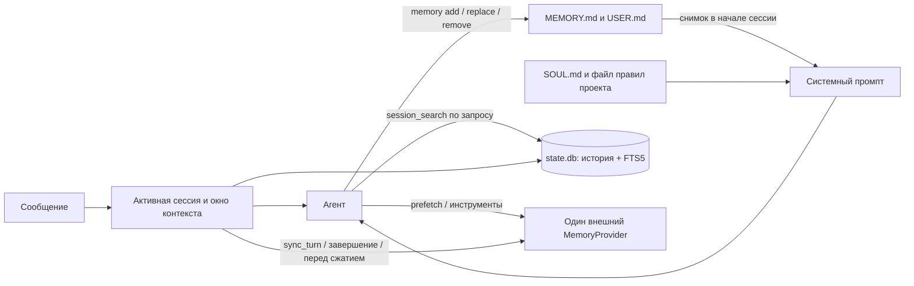

# Память Hermes при проектировании бота

**Проверено по исходникам тега `v2026.9.14` 15 октября 2026 года.** Это справочник для проектирования, а не описание включённой памяти конкретного контейнера. Профили, секреты и пользовательские записи остаются вне этого репозитория.

## Сначала различать три состояния

| Состояние | Что оно доказывает | Где проверять |
| --- | --- | --- |
| Текущий официальный сайт | Как Hermes описывает функцию сейчас | [Persistent Memory](https://hermes-agent.nousresearch.com/docs/user-guide/features/memory), [Memory Providers](https://hermes-agent.nousresearch.com/docs/user-guide/features/memory-providers) |
| Закреплённый `v2026.9.14` | Что описано и реализовано в базовом upstream теге | [Документация памяти тега](https://github.com/NousResearch/hermes-agent/blob/v2026.9.14/website/docs/user-guide/features/memory.md), [исходник MemoryStore](https://github.com/NousResearch/hermes-agent/blob/v2026.9.14/tools/memory_tool_store.py), [MemoryManager](https://github.com/NousResearch/hermes-agent/blob/v2026.9.14/agent/memory_manager.py) |
| Конкретный бот на VPS | Какие файлы, флаги, инструменты и провайдер действительно работают | [Реестр сервисов](/srv/repos/agent-lab-mvp/docs/HERMES-SERVICES.md), Compose/systemd, image ID, runtime-профиль и пробный запрос |

На текущей странице памяти упоминается действие `patch`; в [документации тега](https://github.com/NousResearch/hermes-agent/blob/v2026.9.14/website/docs/user-guide/features/memory.md#memory-tool-actions) перечислены `add`, `replace`, `remove`. Пока образ конкретного бота не проверен, проектировать для закреплённой базы следует с этими тремя действиями. Наличие раздела в официальных документах не подтверждает активацию функции в профиле. Каталог страниц и соответствий тегу: [`data/docs-catalog.json`](../data/docs-catalog.json).

## Карта памяти



**Основная граница:** текущий контекст сессии, короткие постоянно подаваемые факты и доступная по запросу история выполняют разные задачи. `MEMORY.md` и `USER.md` попадают в системный промпт один раз при начале сессии. Их изменение записывается на диск сразу, но блок уже идущей сессии остаётся прежним; ответ инструмента показывает актуальное состояние. Это сохраняет стабильный префикс промпта. [Источник: документация памяти тега](https://github.com/NousResearch/hermes-agent/blob/v2026.9.14/website/docs/user-guide/features/memory.md#how-memory-appears-in-the-system-prompt).

| Слой | Где живёт и как читается | Для чего использовать | Чего там не хранить |
| --- | --- | --- | --- |
| `SOUL.md` | В профиле; загружается при старте сессии | Роль, тон, устойчивые принципы поведения | Лог бесед, переменные факты о пользователе |
| `.hermes.md` или `AGENTS.md` проекта | В репозитории проекта; контекст правил | Архитектура, команды, ограничения конкретного проекта | Личные предпочтения и секреты |
| `USER.md` | `$HERMES_HOME/memories/USER.md`; снимок в промпте; штатный предел **1375 символов** | Долговременные предпочтения и профиль пользователя | Предположения о личности, временные обстоятельства, закрытые данные |
| `MEMORY.md` | `$HERMES_HOME/memories/MEMORY.md`; снимок в промпте; штатный предел **2200 символов** | Сжатые факты о среде, проектах, повторяемых договорённостях и выводах | Полные документы, логи, задачи, транзакции и права доступа |
| История сессий | `$HERMES_HOME/state.db`, SQLite + FTS5; `session_search` по запросу | Точные прошлые реплики, решения и контекст с указанием исходного сообщения | Гарантию семантического поиска или автоматически проверенную «истину» |
| Skills | Папка навыков профиля; загружаются по механике skills | Повторяемые процедуры и инструкции | Персональные факты вместо `USER.md` |
| Предметное хранилище | БД, Git, документы, ledger или сервис конкретного бота | Финансовые суммы, задачи, документы, разрешения, записи с provenance | Подмену их копией в разговорной памяти |
| Внешний `MemoryProvider` | Отдельный backend и инструменты; один выбранный провайдер на профиль | Смысловой recall, масштабный корпус, временные связи, межагентное знание | Неявную замену первичного источника данных |

Для файлов роли и правил сверяться с [Which File Does What тега](https://github.com/NousResearch/hermes-agent/blob/v2026.9.14/website/docs/user-guide/which-file-does-what.md). `SOUL.md` загружается отдельно от одного выбранного типа проектного файла; для проектного контекста действует приоритет `.hermes.md` → `AGENTS.md` → `CLAUDE.md` → `.cursorrules`. Профиль разделяет Hermes state через `HERMES_HOME`, но не ограничивает права ОС или доступ инструментов к файловой системе. [Profiles тега](https://github.com/NousResearch/hermes-agent/blob/v2026.9.14/website/docs/user-guide/profiles.md).

Системный промпт и память направляют модель, но не обеспечивают технические запреты. Доступ к файлам, сервисам и побочным действиям ограничивается отдельными правами, mounts, настройками инструментов и подтверждениями.

## Жизненный цикл

1. **Создание профиля.** У каждого бота отдельный Hermes home: `config.yaml`, `.env`, `SOUL.md`, `memories/`, `state.db`, skills и cron. Два пишущих процесса на одном home смешивают память и сессии; для нового бота нужен собственный профиль. `hermes profile create <имя> --clone` переносит в том числе `MEMORY.md` и `USER.md`, поэтому чистый профиль безопаснее как исходная точка для новой роли. [Profiles тега](https://github.com/NousResearch/hermes-agent/blob/v2026.9.14/website/docs/user-guide/profiles.md#clone-config-only---clone).
2. **Начало сессии.** Hermes читает memory-файлы, убирает точные дубли и формирует фиксированный снимок для системного промпта. Подозрительные записи при загрузке заменяются в снимке заглушкой, но остаются в файле до исправления. Файлы, вручную превышающие лимит, не обрезаются автоматически; новые записи будут заблокированы до сокращения. [MemoryStore тега](https://github.com/NousResearch/hermes-agent/blob/v2026.9.14/tools/memory_tool_store.py).
3. **Ход беседы.** Сообщения и вызовы инструментов сохраняются в истории сессии. Агент может вызвать `memory` для отобранного факта. Запись защищена блокировкой файла и атомарной заменой, поэтому читатель не получает обрезанный файл. Это защита целостности записи, а не подтверждение правильности факта. [MemoryStore тега](https://github.com/NousResearch/hermes-agent/blob/v2026.9.14/tools/memory_tool_store.py), [Sessions тега](https://github.com/NousResearch/hermes-agent/blob/v2026.9.14/website/docs/user-guide/sessions.md).
4. **После ответа.** Автоматический background review может выделить устойчивые факты или процедуры и обновить память/навыки. Если `memory.write_approval: true`, штатные записи памяти из ответа и review требуют одобрения; для skills есть отдельный `skills.write_approval`. Внешний backend имеет собственную логику записи и собственные меры контроля. [Memory тега](https://github.com/NousResearch/hermes-agent/blob/v2026.9.14/website/docs/user-guide/features/memory.md#controlling-memory-writes-write_approval).
5. **Граница сессии.** Telegram и другие gateway-чаты продолжают одну сессию через рестарт. `/new` создаёт явную границу: следующий промпт получает новый снимок memory-файлов, а детали старого разговора ищутся через `session_search`. `/compress` уменьшает активный контекст и создаёт continuation с lineage; это не удаление истории и не эквивалент запланированной смены темы. Для устойчивой привычки завершать задачи используйте `/new`. [Memory тега](https://github.com/NousResearch/hermes-agent/blob/v2026.9.14/website/docs/user-guide/features/memory.md#memory-needs-session-boundaries), [Sessions тега](https://github.com/NousResearch/hermes-agent/blob/v2026.9.14/website/docs/user-guide/sessions.md#session-hygiene-why-you-should-still-run-new).

`session_search` ищет **исходные сообщения**, а не генерирует сводку: `query` для обнаружения, `session_id` + `around_message_id` для прокрутки, один `session_id` для чтения сессии, вызов без аргументов для списка недавних. FTS5 лучше подходит для известных слов и идентификаторов; при перефразировании запросов может понадобиться несколько вариантов или внешний семантический backend. `hermes sessions optimize` обслуживает индекс/БД без удаления истории; `prune` удаляет старые завершённые сессии. [Sessions тега](https://github.com/NousResearch/hermes-agent/blob/v2026.9.14/website/docs/user-guide/sessions.md#session-search-tool).

## Встроенные записи и управление

В `v2026.9.14` инструмент `memory` имеет `add`, `replace`, `remove` и цели `memory`/`user`; отдельного `read` нет. Для `replace` и `remove` нужен уникальный фрагмент `old_text`; несколько совпадений дают ошибку. Разделитель записей в файлах — `§`. Точные дубли пропускаются, а проверка на известные шаблоны prompt injection и exfiltration может отклонить запись. Лимиты считаются в **символах** с разделителями, не в токенах; автоматического уплотнения при переполнении нет. Агенту нужно удалить или объединить старое и повторить запись. [Документация](https://github.com/NousResearch/hermes-agent/blob/v2026.9.14/website/docs/user-guide/features/memory.md#capacity-management), [реализация](https://github.com/NousResearch/hermes-agent/blob/v2026.9.14/tools/memory_tool_store.py).

Начальная конфигурация **для пилота персонального бота**, если требуется контроль фактов:

```yaml
memory:
  memory_enabled: true
  user_profile_enabled: true
  memory_char_limit: 2200
  user_char_limit: 1375
  write_approval: true
display:
  memory_notifications: on
auxiliary:
  background_review:
    enabled: true
```

Значения лимитов и `enabled: true` соответствуют штатному поведению; `write_approval: true` здесь **осознанно меняет умолчание** (`false`). На gateway-канале записи будут ожидать `/memory pending`, `/memory approve <id>` или `/memory reject <id>`; без регулярного разбора очередь не превращается в память. В CLI foreground-записи подтверждаются в диалоге. `display.memory_notifications: off` скрывает уведомление, но не останавливает review или запись. `auxiliary.background_review.enabled: false` отключает автоматический post-turn review, сохраняя ручной `/refine`. [Документация настроек памяти тега](https://github.com/NousResearch/hermes-agent/blob/v2026.9.14/website/docs/user-guide/features/memory.md#configuration).

Для транзакционного бота, где память не должна самопроизвольно интерпретировать операции, можно оставить короткие curated `USER.md`/`MEMORY.md` с approval и выставить `auxiliary.background_review.enabled: false`; предметные события писать в собственную БД. Если вообще не нужны штатные файлы, `memory_enabled: false` вместе с `user_profile_enabled: false` убирают встроенный `memory` tool, но **не отключают внешний провайдер**. `agent.disabled_toolsets: [memory]` скрывает также инструменты внешнего провайдера; отдельно проверяйте его backend hooks и конфигурацию, прежде чем считать сбор данных выключенным. [Документация тега](https://github.com/NousResearch/hermes-agent/blob/v2026.9.14/website/docs/user-guide/features/memory.md#configuration), [MemoryManager тега](https://github.com/NousResearch/hermes-agent/blob/v2026.9.14/agent/memory_manager.py).

## Внешний провайдер: что добавляет и когда нужен

Через `memory.provider` выбирается **не более одного** внешнего `MemoryProvider` на профиль. Он может дать статический блок в промпте, извлечь релевантный контекст перед ходом (`prefetch`), выставить свои инструменты поиска, синхронизировать завершённый ход (`sync_turn`) и обработать завершение сессии, запись встроенной памяти или сжатие (`on_session_end`, `on_memory_write`, `on_pre_compress`). Это доступные точки контракта; конкретный провайдер может реализовывать только часть. Штатные файлы продолжают работать параллельно, если они включены. [Контракт тега](https://github.com/NousResearch/hermes-agent/blob/v2026.9.14/agent/memory_provider.py), [руководство разработчика тега](https://github.com/NousResearch/hermes-agent/blob/v2026.9.14/website/docs/developer-guide/memory-provider-plugin.md).

`prefetch` ограничен тайм-аутом, сбой отдельного backend обычно не блокирует ответ; `sync_turn` ставится в последовательную фоновую очередь. Поэтому сразу после ответа новая запись провайдера может ещё не быть доступна, а пропущенный `prefetch` не означает отсутствие сохранённых данных. При смене сессии менеджер упорядочивает завершение старой и привязку новой. Для критичных данных нужно проверять durable commit в собственном хранилище, а не считать очередной hook транзакционной гарантией. [MemoryManager тега](https://github.com/NousResearch/hermes-agent/blob/v2026.9.14/agent/memory_manager.py).

Провайдер выбирают только по измеримому пробелу штатной схемы:

| Потребность | Сначала проверить | Когда пробовать внешний backend |
| --- | --- | --- |
| Несколько десятков важных фактов | Короткие curated записи + `/new` | Постоянно не помещаются, нужна автоматическая консолидация |
| Точная старая беседа | `session_search` по словам и исходным репликам | Перефразированные запросы систематически не находятся |
| Большой корпус документов | Поиск по исходным файлам/БД с цитированием | Нужна дополнительная навигация по смыслу, связям или времени |
| Общая память нескольких ботов | Чёткие владельцы данных и отдельные профили | Требуются общие сведения с ACL, provenance и изоляцией собеседников |
| Финансовые и task-состояния | Предметная БД/API | Провайдер может подсказывать контекст, но не заменять запись операции |

Сравнение bundled и сторонних решений, зависимостей, рисков и исследований: [обзор провайдеров](./hermes-memory-providers-review-2026-10-15.md). В теге восемь bundled реализаций; наличие в каталоге или установленного пакета ещё не означает совместимости с производным образом бота. При подключении проверить идентификацию пользователя, область данных, хранение/удаление, сетевые вызовы, задержку, счёт и поведение при ошибке. `memory.write_approval` контролирует штатный `memory` tool, а не автоматически все ingest-hooks стороннего провайдера.

## Рецепт для нового бота на этом VPS

1. Найти исходный репозиторий бота и сервис в [`CODEX_PROJECTS.md`](/home/ubuntu/Projects/CODEX_PROJECTS.md) и [реестре Hermes](/srv/repos/agent-lab-mvp/docs/HERMES-SERVICES.md). Зафиксировать тег/digest базового образа, локальные патчи, Compose/systemd, монтирования, `HERMES_HOME` и владельца runtime-профиля. Изменение этого справочника само по себе не меняет работающий контейнер.
2. Выделить отдельный профиль и storage. Составить короткие `SOUL.md` и проектный context-файл в соответствующем исходном репозитории. Не переносить память из другого бота через `--clone` без просмотра каждого факта. Токены, `.env`, `state.db`, реальные `MEMORY.md`/`USER.md` и личные документы держать вне Git.
3. Решить, какие факты обязаны быть в каждом новом промпте. Поместить лишь их в `USER.md`/`MEMORY.md`; для остального определить первичный источник и поиск. Для многопользовательского gateway проверить, что профильная память не смешивает личные данные разных людей: штатные файлы относятся к **профилю**, а не автоматически к каждому собеседнику.
4. Выбрать политику записей и ревью: свободная запись или `write_approval`, включённый/выключенный background review, отдельное одобрение skills. Если выбран внешний провайдер, зафиксировать его имя, версию, storage, credential scope, per-user mapping и способ проверки ingest/recall.
5. На тестовом профиле проверить: запись предпочтения; `/new` и появление его в новом снимке; `session_search` для детали старой беседы; отказ при превышении лимита; очередь `/memory pending`; отсутствие доступа одного бота к чужим данным. Для провайдера проверить recall, задержку фоновой синхронизации, сбой backend и удаление тестовых данных. После этого документировать конфигурацию в репозитории бота и выпускать только его сервис по собственному runbook.

## Диагностика

| Симптом | Первая проверка |
| --- | --- |
| Записанный факт не виден в системном блоке | Была ли после записи новая сессия (`/new`); ответ `memory` показывает живое состояние, а снимок заморожен |
| Агент «забыл» старый разговор | Запрос `session_search` по словам/идентификаторам, затем просмотр исходной реплики; `state.db` и профиль нужного бота |
| `memory` недоступен | `memory_enabled`/`user_profile_enabled`, `agent.disabled_toolsets`, фактическая конфигурация контейнера |
| Запись не появилась на диске | `write_approval`, `/memory pending`, ошибка лимита, уникальность `old_text`, журнал инструмента |
| Нет инструмента внешнего backend | `memory.provider`, установка/доступность плагина и credentials, разрешённый toolset, журналы регистрации |
| Внешний recall пуст или запаздывает | Время `prefetch`, очередь `sync_turn`, mapping пользователя/сессии, доступность backend и тайм-аут |
| После рестарта чат всё ещё длинный | Gateway сохраняет сессию; выполнить `/new` на границе темы, а не рассчитывать на рестарт |

Этот документ описывает базовую архитектуру; параметры конкретного бота следует утверждать после проверки его фактического образа и профиля. Правила выбора остальных механизмов Hermes: [decision guide](../skills/hermes-agent-architect/references/decision-guide.md).
